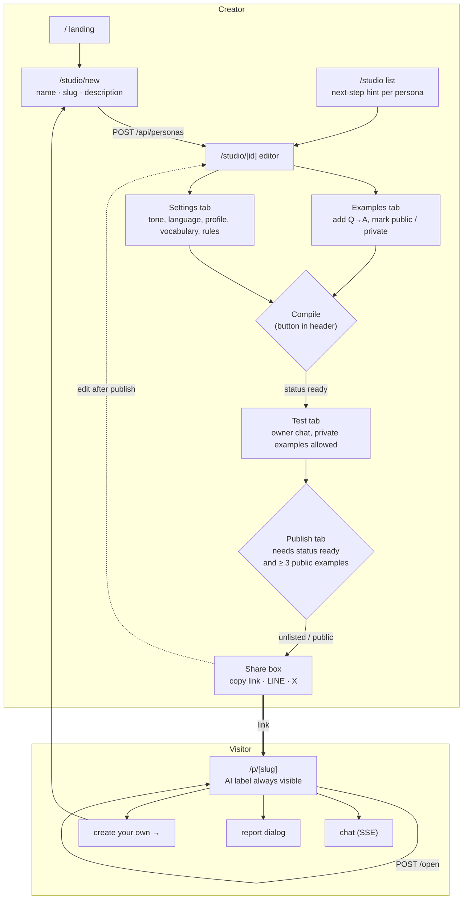
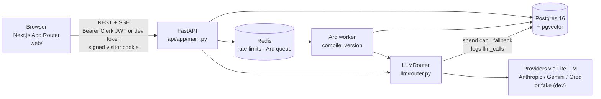
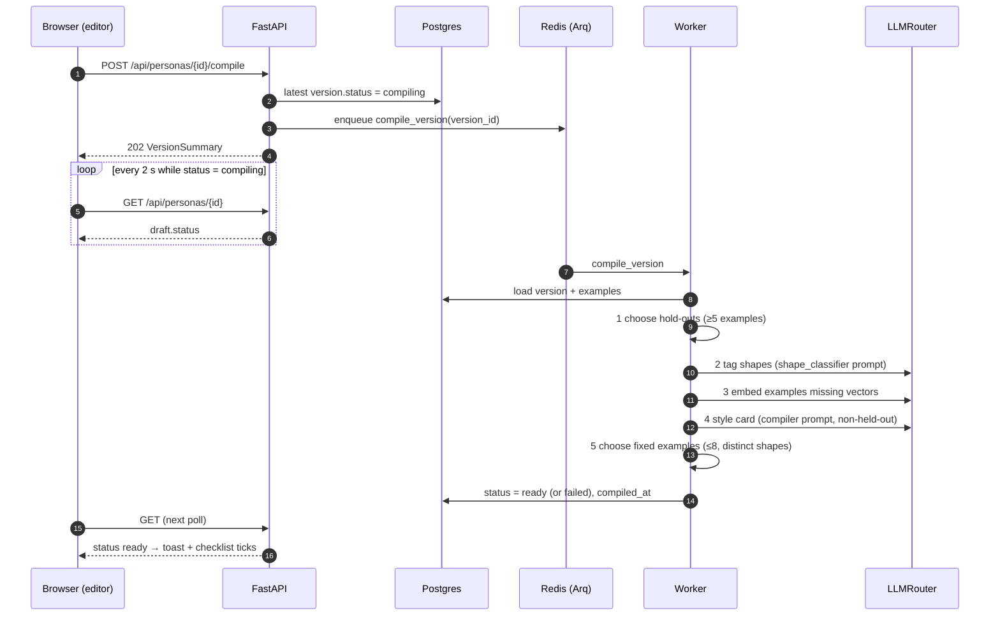
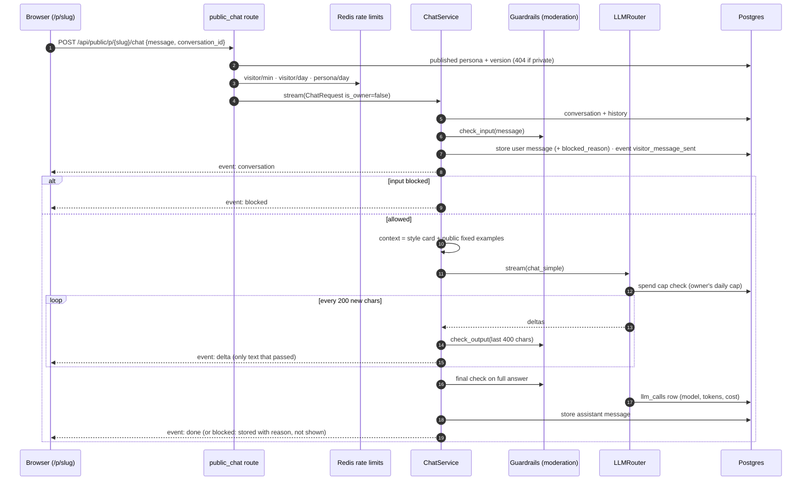
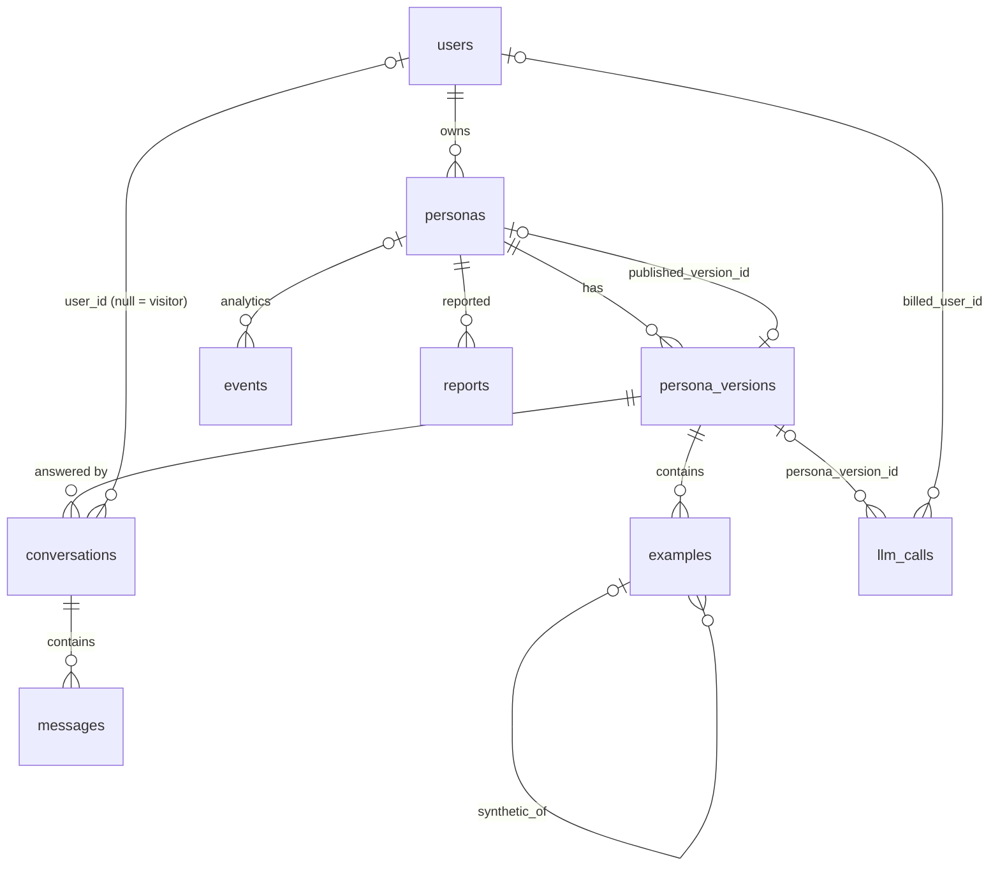

# Flows — how the web app works end to end

Diagrams of the Phase 1A app as built (M0–M4a + the UI redesign). Each diagram names the code
that implements it; the table at the end maps every step to a file. Update this file when a flow
changes. Design intent lives in `ARCHITECTURE.md`; this file describes what the code does today.

## 1. User flow

Two people: the **creator** (signed in, uses `/studio`) and the **visitor** (anonymous, opens a
shared `/p/<slug>` link).

Notes
- The editor's checklist (basics · 3 examples · 3 public · compiled · published) is computed in the
  browser from the loaded persona (`web/src/lib/persona-progress.ts`); the API enforces the real
  publish rule in `services/persona.py::publish`.
- Editing a published persona clones it into a new draft version first (hard rule 2), so the
  shared link keeps serving the published version until the creator publishes again.

## 2. System architecture

Hard rules visible in this picture
- **1** — only `LLMRouter` talks to providers; the browser never does.
- **3** — visitor context uses public (or synthetic) examples only (`services/context.py`).
- **4** — every answer passes guardrails before it streams (`services/guardrails.py`).
- **6** — public endpoints are rate limited in Redis (`services/ratelimit.py`).

## 3. Sequence — compile

## 4. Sequence — visitor chat (SSE)

The owner's test chat (`POST /api/personas/{id}/test-chat`) runs the same `ChatService` with
`is_owner=true`: private examples are allowed and visitor rate limits do not apply (the spend cap
still does).

## 5. Data model

Settings (`language`, `tone`, `profile{}`, `vocabulary{}`, …), `rules`, `style_card` and
`fixed_example_ids` live on `persona_versions`. Phase 2+ tables already in `db/schema.sql` but
unused in 1A: `knowledge_chunks`, `likes`, `eval_runs`.

## Where in the code

| Step | Web | API |
|---|---|---|
| Landing, studio list, create | `web/src/app/page.tsx`, `app/studio/page.tsx`, `app/studio/new/page.tsx` | `routes/personas.py` → `services/persona.py::create_persona`, `list_personas` |
| Editor + checklist | `app/studio/[id]/page.tsx`, `components/persona/*`, `lib/persona-progress.ts` | `routes/personas.py` (get, patch, examples) |
| New draft on edit | — | `services/persona.py::ensure_editable_version` |
| Compile | header button + 2 s poll in `app/studio/[id]/page.tsx` | `services/persona.py::start_compile` → `workers/compile.py` → `services/compile.py::Compiler` |
| Publish / unpublish | `components/persona/publish-panel.tsx` | `services/persona.py::publish`, `unpublish` |
| Public page + open event | `app/p/[slug]/page.tsx`, `components/chat/public-chat.tsx` | `routes/public.py` (get, `/open`) |
| Chat UI + SSE parsing | `components/chat/chat-panel.tsx`, `lib/api/sse.ts` | `routes/public.py::public_chat`, `routes/personas.py::test_chat` → `services/chat.py` |
| Context | — | `services/context.py` (`visible_examples`, `fixed_examples`) |
| Guardrails | blocked bubble in `chat-panel.tsx` | `services/guardrails.py`, `services/moderation.py` |
| Rate limits | — | `services/ratelimit.py` |
| LLM calls, spend cap, logging | never (hard rule 1) | `llm/router.py` |
| Report | `components/chat/report-dialog.tsx` | `routes/public.py::report_persona` |
| Auth | `lib/auth/context.tsx`, `proxy.ts` | `app/auth.py` (Clerk JWKS; `dev:<id>` tokens when `AUTH_DEV_BYPASS=true`), `app/visitor.py` (signed visitor cookie) |
